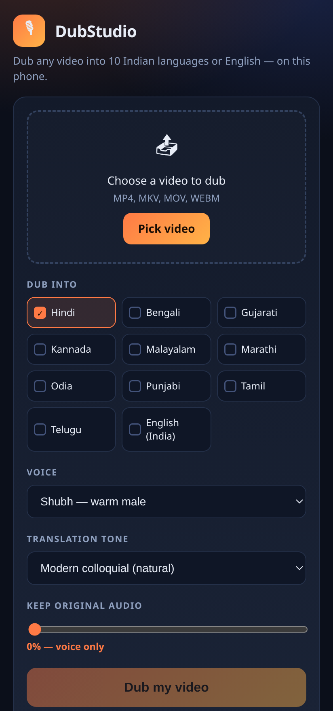
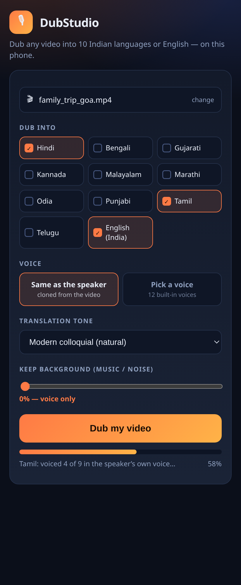
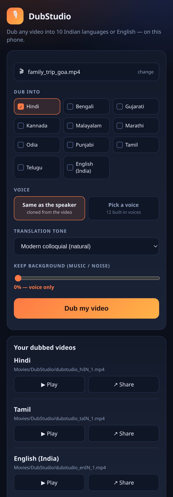

# DubStudio

**Dub any video into 10 Indian languages or English — on your phone.**

Pick a video, tick the languages you want, press one button. DubStudio listens to the
original speech, translates it, records a new voice in the target language, and writes a
new MP4 with the video stream untouched. You get one video per language, plus subtitles.

| Home | Dubbing | Results |
|---|---|---|
|  |  |  |

## Download

**[⬇ DubStudio.apk](DubStudio.apk)** — 38 KB, signed, Android 8.0 (API 26) and up,
targets Android 16 (API 36). **One permission: `INTERNET`.** No account, no ads, no
tracking.

## Permissions

The app declares exactly one permission:

```
android.permission.INTERNET
```

That is the whole list. Videos are opened with the system document picker
(`ACTION_OPEN_DOCUMENT`), which grants access to that one file and needs no storage
permission; the dubbed result is saved through `MediaStore`, which also needs none.

> **Note on v1.0.** The first build shipped without a `<uses-sdk>` element in the
> manifest, so Android treated it as `targetSdkVersion 1` and *implied* legacy
> permissions — `READ_PHONE_STATE`, `READ_EXTERNAL_STORAGE`, `WRITE_EXTERNAL_STORAGE`
> and friends. Google Play flags `READ_PHONE_STATE` as a sensitive permission and asks
> for a declaration form, which is why v1.0 looked alarming. v1.1 declares
> `minSdkVersion 26` and `targetSdkVersion 36` explicitly and the implied list is gone.

## What it does

1. Reads the audio track out of the video with `MediaExtractor` + `MediaCodec` and
   decodes it to mono PCM.
2. Finds the spoken parts by measuring energy per 20 ms window, and cuts the audio into
   chunks of at most 26 seconds — the speech-to-text API's per-request limit.
3. Transcribes each chunk with **Saaras** (`saaras:v3`). The language is detected
   automatically on the first chunk and reused for the rest, so you never have to say
   what language the video is in.
4. Translates each chunk with **Mayura** (`mayura:v1`) into every language you picked.
5. Records the voice for each chunk with **Bulbul** (`bulbul:v3`).
6. Places each voice clip at its original timestamp. If the translation runs longer than
   the slot it has to fit, the clip is sped up (up to 2×) so it stays in sync.
7. Encodes the new audio to AAC and muxes it onto the **untouched** video stream with
   `MediaMuxer` — no video re-encoding, so it's fast and lossless.
8. Saves the result to `Movies/DubStudio/` so it shows up in your gallery.

Transcription happens once and is reused for every target language, so dubbing into four
languages costs about the same as dubbing into one, plus translation and voice.

## Languages

Hindi · Bengali · Gujarati · Kannada · Malayalam · Marathi · Odia · Punjabi · Tamil ·
Telugu · English (India)

Input can be any of the 22 scheduled Indian languages or English — detection handles it.
Voice output covers the 11 above.

## Setup

Install the APK, open it, and paste your Sarvam API key (free credits at
[dashboard.sarvam.ai](https://dashboard.sarvam.ai)). The key is stored only on the
device in `SharedPreferences` and is never sent anywhere except `api.sarvam.ai`.

Nothing else to configure. No login, no server, no cloud storage.

## Using it

1. **Pick video** — any MP4, MKV, MOV or WEBM with an audio track.
2. Tick one or more **languages**.
3. Choose a **voice** and a **translation tone**:
   - *Modern colloquial* — how people actually talk, mixes English words in. Best for
     reels and vlogs.
   - *Formal* — clean, literary. Best for documentaries and official content.
   - *Classic colloquial* — a middle ground.
   - *Code-mixed* — heavy Hinglish-style mixing.
4. Optionally keep the **original audio** underneath at 10–20% so background music
   survives (the original speech stays in there too, at that volume).
5. Press **Dub my video**. Progress is shown live; each finished video gets Play and
   Share buttons.

A one-minute video takes roughly a minute — most of the time is API round trips.

## Building from source

The APK is built without Gradle: `aapt2` → `javac` → `d8` → `zipalign` → `apksigner`.

```bash
# needs JDK 17+, Android build-tools 34, platform android-34
export ANDROID_SDK=$HOME/Android/Sdk
./build.sh          # produces DubStudio.apk
```

Source layout:

```
app/AndroidManifest.xml
app/assets/index.html              the whole UI (no build step)
app/java/com/rajok/dubstudio/
    MainActivity.java              WebView shell + JS bridge + file picker
    DubbingEngine.java             VAD, chunking, timing, encode + mux
    Sarvam.java                    speech-to-text, translate, text-to-speech
    Audio.java                     decode, resample, WAV read/write
    FileProviderLite.java          lets the player and share sheet read the output
app/res/                           theme, strings, launcher icons
build.sh
```

The UI is plain HTML/CSS/JS in a `WebView`; all media work happens in Java behind a
small `@JavascriptInterface` bridge (`DubBridge`).

## Desktop version

There is also a Python/FastAPI version of the same pipeline in [`desktop/`](desktop/) for
batch work on a computer — same API calls, same logic, ffmpeg instead of MediaCodec.
See [desktop/README.md](desktop/README.md).

## Limitations

- **No diarization.** Every voice in the video is replaced by one TTS voice. Multi-speaker
  videos get a single narrator.
- **No lip-sync.** The dub is timed to the original segments, not to mouth movements.
- **Translation length.** Heavily expanded translations get sped up to fit their slot,
  which can sound rushed. Pick a slower voice or split the video.
- **Memory.** The whole audio track is held in memory while dubbing; very long videos
  (30 min+) may be rejected by Android's heap limit.
- **Status.** The pipeline logic was validated against the live Sarvam API on the desktop
  build; the Android build is compile-verified and signed but has not been run on a
  physical device in this repository's CI. If something misbehaves, open an issue with
  the video format and the language you used.
- **Play Store.** The APK targets API 36 and declares one permission, so it satisfies
  Play's target-API and permission rules. Publishing also needs a Data safety form
  (audio → collected, shared with Sarvam AI for processing, not used for tracking),
  a privacy policy URL ([PRIVACY.md](PRIVACY.md)) and the AI-generated-content
  declaration.

## Privacy

Your video never leaves the device. Only short mono audio chunks (≤26 s) are sent to
`api.sarvam.ai` for transcription, and the resulting text to the translation and
voice endpoints. No analytics, no telemetry, no third-party SDKs.

The full policy — including the Data safety answers to give Google Play — is in
[PRIVACY.md](PRIVACY.md).

## Licence

MIT — see [LICENSE](LICENSE).
