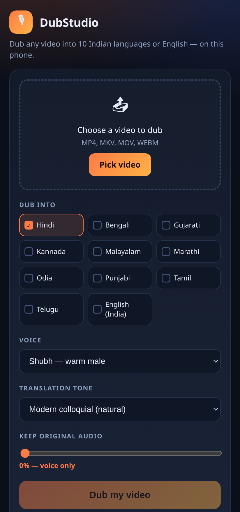
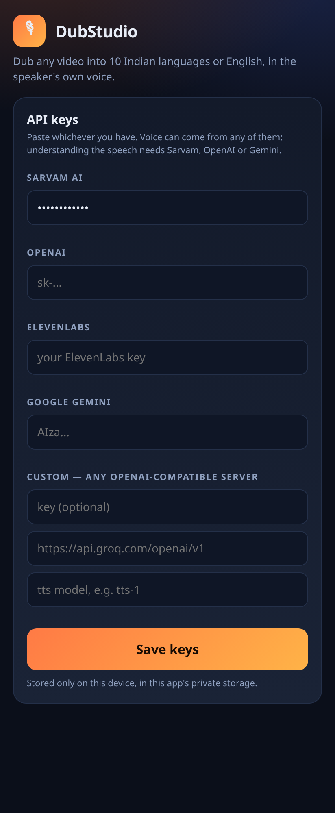
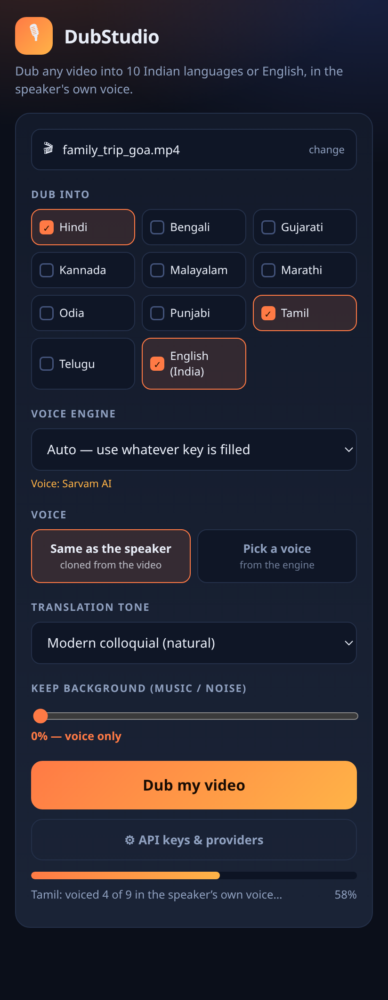
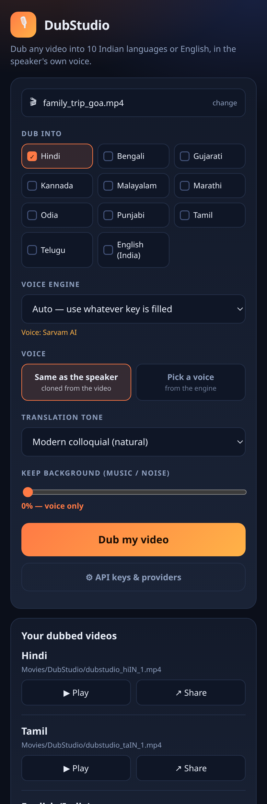

# DubStudio

**Dub any video into 10 Indian languages or English — on your phone.**

Pick a video, tick the languages you want, press one button. DubStudio listens to the
original speech, translates it, records a new voice in the target language, and writes a
new MP4 with the video stream untouched. You get one video per language, plus subtitles.

| Home | API keys | Dubbing | Results |
|---|---|---|---|
|  |  |  |  |

## Download

**[⬇ DubStudio.apk](DubStudio.apk)** — 38 KB, signed, Android 8.0 (API 26) and up,
targets Android 16 (API 36). **One permission: `INTERNET`.** No account, no ads, no
tracking.

## Voice providers — bring any key

There is no single provider lock-in for the voice. Paste whichever keys you have in
**API keys & providers** and pick an engine, or leave it on *Auto* and the app uses
whatever is filled.

| Engine | Voice | Speech to text | Translate | Voice cloning |
|---|---|---|---|---|
| Sarvam AI | Bulbul `bulbul:v3` | Saaras `saaras:v3` | Mayura `mayura:v1` | **yes** |
| OpenAI | `tts-1` | `whisper-1` | `gpt-4o-mini` | no |
| ElevenLabs | `eleven_multilingual_v2` | — | — | no |
| Google Gemini | `gemini-2.5-flash-preview-tts` | `gemini-2.5-flash` | `gemini-2.5-flash` | no |
| Custom | any OpenAI-compatible `/audio/speech` | — | — | no |

The **Custom** row is the escape hatch for anything that speaks the OpenAI audio API —
Groq, Together, DeepInfra, a local server, an OpenAI-compatible proxy. Give it a base URL
like `https://api.groq.com/openai/v1` and a TTS model name.

You can mix and match. An ElevenLabs key for the voice plus an OpenAI key for the
transcript is a valid setup: ElevenLabs cannot transcribe, so the app quietly uses
OpenAI or Gemini for that half. If no key can transcribe, it says so before starting
rather than failing halfway.

Audio formats are handled per provider: OpenAI returns WAV, ElevenLabs is asked for
`pcm_44100`, Gemini returns raw 24 kHz PCM, and all three are decoded to the same
internal mix rate.

**Cloning is the one exception.** Instant Voice Cloning exists at Sarvam and not at the
others, so *Same as the speaker* is only offered when the resolved engine is Sarvam; the
button greys out otherwise and the picked voice is used instead.

## Permissions

The app declares exactly one permission:

```
android.permission.INTERNET
```

That is the whole list. Videos are opened with the system document picker
(`ACTION_OPEN_DOCUMENT`), which grants access to that one file and needs no storage
permission; the dubbed result is saved through `MediaStore`, which also needs none.

> **Note on v1.0.** The first build shipped without a `<uses-sdk>` element in the
> manifest, so Android treated it as `targetSdkVersion 1` and *implied* legacy
> permissions — `READ_PHONE_STATE`, `READ_EXTERNAL_STORAGE`, `WRITE_EXTERNAL_STORAGE`
> and friends. Google Play flags `READ_PHONE_STATE` as a sensitive permission and asks
> for a declaration form, which is why v1.0 looked alarming. v1.1 declares
> `minSdkVersion 26` and `targetSdkVersion 36` explicitly and the implied list is gone.

## The speaker's own voice

The default is **Same as the speaker**. Before dubbing, the app takes about twelve
seconds of the cleanest speech from the video, sends it to Sarvam's Instant Voice
Cloning endpoint (`POST /voices/create`) and gets back a `voice_id`. Every dubbed line is
then spoken with `POST /voices/clone` in that voice — including across languages, so a
Hindi speaker can come out sounding like themselves in Tamil.

If cloning is unavailable (no quota for it, noisy reference, or a very short video), the
app says so in the progress line and falls back to the voice you picked. You can also
choose **Pick a voice** to skip cloning entirely and use one of twelve built-in speakers.

> Cloning copies a real person's voice. Only dub videos you have the right to use that
> way.

## Keeping the background

A stereo video gives a free trick: the voice is almost always mixed dead centre, so
`(left - right) / 2` cancels it and leaves the music, traffic and room tone behind. The
app decodes both channels, keeps that residual as the bed, and mixes it under the new
voice at whatever level the *Keep background* slider says.

Mono sources have no centre to cancel, so there the original is simply ducked to 45% of
the chosen level — the old voice is still faintly there. If the side channel turns out to
be empty, the app falls back to that same ducked mix.

Set the slider to 0% for voice only, or around 60-100% to keep the music.

## What it does

1. Reads the audio track out of the video with `MediaExtractor` + `MediaCodec` and
   decodes it to mono PCM, keeping the mid/side residual as the background bed.
2. Finds the spoken parts by measuring energy per 20 ms window, and cuts the audio into
   chunks of at most 26 seconds — the speech-to-text API's per-request limit.
3. Transcribes each chunk with **Saaras** (`saaras:v3`). The language is detected
   automatically on the first chunk and reused for the rest, so you never have to say
   what language the video is in.
4. Translates each chunk with **Mayura** (`mayura:v1`) into every language you picked.
5. Records the voice for each chunk — with **Instant Voice Cloning** by default, or
   **Bulbul** (`bulbul:v3`) if you picked a voice.
6. Places each voice clip at its original timestamp. If the translation runs longer than
   the slot it has to fit, the clip is sped up (up to 2×) so it stays in sync.
7. Encodes the new audio to AAC and muxes it onto the **untouched** video stream with
   `MediaMuxer` — no video re-encoding, so it's fast and lossless.
8. Saves the result to `Movies/DubStudio/` so it shows up in your gallery.

Transcription happens once and is reused for every target language, so dubbing into four
languages costs about the same as dubbing into one, plus translation and voice.

## Speed

Chunks are independent, so they no longer wait for each other: speech-to-text,
translation and voice generation all run four at a time across a small thread pool.
Mixing stays sequential and in order, so the timing is unchanged.

On a 1 minute 50 second test clip (five chunks, one target language) the same job went
from **42.7 s to 29.4 s**. The gain grows with the length of the video, because the
number of parallel chunks grows while the fixed overhead does not.

The desktop build reads the concurrency from `DUB_WORKERS` (default 4):

```bash
DUB_WORKERS=6 python app.py
```

If you start seeing HTTP 429 responses, lower it.

## Languages

Hindi · Bengali · Gujarati · Kannada · Malayalam · Marathi · Odia · Punjabi · Tamil ·
Telugu · English (India)

Input can be any of the 22 scheduled Indian languages or English — detection handles it.
Voice output covers the 11 above.

## Setup

Install the APK, open it, and paste your Sarvam API key (free credits at
[dashboard.sarvam.ai](https://dashboard.sarvam.ai)). The key is stored only on the
device in `SharedPreferences` and is never sent anywhere except `api.sarvam.ai`.

Nothing else to configure. No login, no server, no cloud storage.

## Using it

1. **Pick video** — any MP4, MKV, MOV or WEBM with an audio track.
2. Tick one or more **languages**.
3. Choose a **voice** and a **translation tone**:
   - *Modern colloquial* — how people actually talk, mixes English words in. Best for
     reels and vlogs.
   - *Formal* — clean, literary. Best for documentaries and official content.
   - *Classic colloquial* — a middle ground.
   - *Code-mixed* — heavy Hinglish-style mixing.
4. Optionally keep the **original audio** underneath at 10–20% so background music
   survives (the original speech stays in there too, at that volume).
5. Press **Dub my video**. Progress is shown live; each finished video gets Play and
   Share buttons.

A one-minute video takes roughly a minute — most of the time is API round trips.

## Building from source

The APK is built without Gradle: `aapt2` → `javac` → `d8` → `zipalign` → `apksigner`.

```bash
# needs JDK 17+, Android build-tools 34, platform android-34
export ANDROID_SDK=$HOME/Android/Sdk
./build.sh          # produces DubStudio.apk
```

Source layout:

```
app/AndroidManifest.xml
app/assets/index.html              the whole UI (no build step)
app/java/com/rajok/dubstudio/
    MainActivity.java              WebView shell + JS bridge + file picker
    DubbingEngine.java             VAD, chunking, timing, encode + mux
    Sarvam.java                    speech-to-text, translate, text-to-speech
    Audio.java                     decode, resample, WAV read/write
    FileProviderLite.java          lets the player and share sheet read the output
app/res/                           theme, strings, launcher icons
build.sh
```

The UI is plain HTML/CSS/JS in a `WebView`; all media work happens in Java behind a
small `@JavascriptInterface` bridge (`DubBridge`).

## Desktop version

There is also a Python/FastAPI version of the same pipeline in [`desktop/`](desktop/) for
batch work on a computer — same API calls, same logic, ffmpeg instead of MediaCodec.
See [desktop/README.md](desktop/README.md).

## Limitations

- **No diarization.** Every voice in the video is replaced by one voice — the cloned one,
  or a single narrator. Multi-speaker videos come out in the first speaker's voice.
- **Cloning is Sarvam-only.** It is the one thing that cannot be swapped for another
  provider, because it is not a commodity API. The desktop build in `desktop/` still
  speaks Sarvam only and has no cloning.
- **Background removal is a stereo trick.** If the voice is not centred in the mix, or the
  file is mono, some of the original voice survives under the dub.
- **No lip-sync.** The dub is timed to the original segments, not to mouth movements.
- **Translation length.** Heavily expanded translations get sped up to fit their slot,
  which can sound rushed. Pick a slower voice or split the video.
- **Memory.** The whole audio track is held in memory while dubbing; very long videos
  (30 min+) may be rejected by Android's heap limit.
- **Status.** The pipeline logic was validated against the live Sarvam API on the desktop
  build; the Android build is compile-verified and signed but has not been run on a
  physical device in this repository's CI. If something misbehaves, open an issue with
  the video format and the language you used.
- **Play Store.** The APK targets API 36 and declares one permission, so it satisfies
  Play's target-API and permission rules. Publishing also needs a Data safety form
  (audio → collected, shared with Sarvam AI for processing, not used for tracking),
  a privacy policy URL ([PRIVACY.md](PRIVACY.md)) and the AI-generated-content
  declaration.

## Privacy

Your video never leaves the device. Only short mono audio chunks (≤26 s) are sent to
`api.sarvam.ai` for transcription, and the resulting text to the translation and
voice endpoints. No analytics, no telemetry, no third-party SDKs.

The full policy — including the Data safety answers to give Google Play — is in
[PRIVACY.md](PRIVACY.md).

## Licence

MIT — see [LICENSE](LICENSE).

---

## ⭐ Like this work? Give it a star

If you like this app and our work, please **star this repository** ⭐ and **[follow technicalnihilist-lgtm on GitHub](https://github.com/technicalnihilist-lgtm)**. If our work isn't for you, that's completely fine — the choice is yours. Thank you for stopping by!

<details>
<summary><b>🌍 Same message in 32 languages (A–Z + Indian languages)</b></summary>

- **A — Arabic** (العربية): ⭐ إذا أعجبك هذا التطبيق وعملنا، فيرجى منح المستودع نجمة ومتابعتنا. وإذا لم يعجبك عملنا، فلا مشكلة على الإطلاق — القرار قرارك. شكرًا لزيارتك!
- **B — Bengali** (বাংলা): ⭐ যদি আপনার এই অ্যাপ এবং আমাদের কাজ ভালো লাগে, তবে অনুগ্রহ করে রিপোজিটরিটিকে একটি স্টার দিন এবং আমাদের ফলো করুন। আমাদের কাজ যদি আপনার পছন্দ না হয়, তাতেও কোনো সমস্যা নেই — সিদ্ধান্ত আপনার। আমাদের পেজে আসার জন্য ধন্যবাদ!
- **C — Chinese** (中文): ⭐ 如果你喜欢这个应用和我们的作品，请给仓库点个星标并关注我们。如果我们的作品不适合你，也完全没关系——选择权在你。感谢你的到访！
- **D — Dutch** (Nederlands): ⭐ Vind je deze app en ons werk leuk? Geef de repository dan een ster en volg ons. Vind je ons werk niets, dan is dat helemaal prima — de keuze is aan jou. Bedankt voor je bezoek!
- **E — English** (English): ⭐ If you like this app and our work, please give the repository a star and follow us. If our work isn't for you, that's completely fine — the choice is yours. Thank you for stopping by!
- **F — French** (Français): ⭐ Si cette application et notre travail vous plaisent, mettez une étoile au dépôt et suivez-nous. Si notre travail n'est pas pour vous, aucun souci — c'est votre choix. Merci de votre visite !
- **G — German** (Deutsch): ⭐ Wenn dir diese App und unsere Arbeit gefallen, gib dem Repository einen Stern und folge uns. Wenn unsere Arbeit nichts für dich ist, ist das völlig in Ordnung — die Wahl liegt bei dir. Danke fürs Vorbeischauen!
- **H — Hindi** (हिन्दी): ⭐ अगर आपको यह ऐप और हमारा काम पसंद है, तो कृपया रिपॉजिटरी को स्टार दें और हमें फॉलो करें। अगर हमारा काम आपके लिए नहीं है, तो भी कोई बात नहीं — यह पूरी तरह आपकी मर्ज़ी है। यहाँ आने के लिए आपका धन्यवाद!
- **I — Indonesian** (Bahasa Indonesia): ⭐ Jika kamu suka aplikasi ini dan karya kami, beri bintang pada repositori ini dan ikuti kami. Kalau karya kami bukan untukmu, tidak masalah sama sekali — itu pilihanmu. Terima kasih sudah mampir!
- **J — Japanese** (日本語): ⭐ このアプリと私たちの仕事が気に入ったら、リポジトリにスターを付けてフォローしてください。合わない場合はまったく問題ありません — 選ぶのはあなたです。お越しいただきありがとうございます！
- **K — Korean** (한국어): ⭐ 이 앱과 저희 작업이 마음에 드신다면 저장소에 스타를 눌러 주시고 팔로우해 주세요. 저희 작업이 맞지 않으셔도 전혀 괜찮습니다 — 선택은 여러분의 몫입니다. 방문해 주셔서 감사합니다!
- **L — Lithuanian** (Lietuvių): ⭐ Jei tau patinka ši programa ir mūsų darbas, duok saugyklai žvaigždutę ir sek mus. Jei mūsų darbas ne tau, viskas gerai — pasirinkimas tavo. Ačiū, kad užsukai!
- **M — Malayalam** (മലയാളം): ⭐ നിങ്ങൾക്ക് ഈ ആപ്പും ഞങ്ങളുടെ പ്രവർത്തനവും ഇഷ്ടപ്പെട്ടെങ്കിൽ, ദയവായി റെപ്പോസിറ്ററിക്ക് ഒരു സ്റ്റാർ നൽകുകയും ഞങ്ങളെ ഫോളോ ചെയ്യുകയും ചെയ്യുക. ഞങ്ങളുടെ പ്രവർത്തനം നിങ്ങൾക്ക് അനുയോജ്യമല്ലെങ്കിൽ, അതും തികച്ചും കുഴപ്പമില്ല — തീരുമാനം നിങ്ങളുടേതാണ്. ഇവിടെ വന്നതിന് നന്ദി!
- **N — Nepali** (नेपाली): ⭐ यदि तपाईंलाई यो एप र हाम्रो काम मन पर्‍यो भने, कृपया रिपोजिटरीलाई स्टार दिनुहोस् र हामीलाई फलो गर्नुहोस्। यदि हाम्रो काम तपाईंलाई मन पर्दैन भने, पनि ठीकै छ — यो तपाईंको इच्छा हो। यहाँ आउनुभएकोमा धन्यवाद!
- **O — Odia** (ଓଡ଼ିଆ): ⭐ ଯଦି ଆପଣଙ୍କୁ ଏହି ଆପ୍ ଏବଂ ଆମର କାମ ଭଲ ଲାଗୁଛି, ତେବେ ଦୟାକରି ରିପୋଜିଟୋରୀକୁ ଗୋଟିଏ ଷ୍ଟାର୍ ଦିଅନ୍ତୁ ଏବଂ ଆମକୁ ଫଲୋ କରନ୍ତୁ। ଯଦି ଆମର କାମ ଆପଣଙ୍କ ପାଇଁ ନୁହେଁ, ତେବେ କିଛି ଅସୁବିଧା ନାହିଁ — ପସନ୍ଦ ଆପଣଙ୍କର। ଆମ ପାଖକୁ ଆସିଥିବାରୁ ଧନ୍ୟବାଦ!
- **P — Polish** (Polski): ⭐ Jeśli podoba Ci się ta aplikacja i nasza praca, daj repozytorium gwiazdkę i obserwuj nas. Jeśli nasza praca nie jest dla Ciebie, to zupełnie w porządku — wybór należy do Ciebie. Dziękujemy za odwiedziny!
- **Q — Quechua** (Runa Simi): ⭐ Kay app, ñuqaykup ruwasqanchikpas gustasunki chayqa, repositorioman huk estrella churay, ñuqaykutapas qatipayku. Mana gustasunki chayqa, allinmi — qampa akllayki. Hamusqaykimanta sulpayki!
- **R — Russian** (Русский): ⭐ Если вам нравится это приложение и наша работа, поставьте звёздочку репозиторию и подпишитесь на нас. Если наша работа не для вас — это совершенно нормально, выбор за вами. Спасибо, что заглянули!
- **S — Spanish** (Español): ⭐ Si te gusta esta app y nuestro trabajo, dale una estrella al repositorio y síguenos. Si nuestro trabajo no es para ti, no pasa nada — la decisión es tuya. ¡Gracias por pasarte!
- **T — Tamil** (தமிழ்): ⭐ உங்களுக்கு இந்த ஆப்பும் எங்க வேலையும் பிடிச்சிருந்தா, தயவுசெஞ்சு இந்த ரெபாசிட்டரிக்கு ஒரு ஸ்டார் குடுத்து, எங்களை ஃபாலோ பண்ணுங்க. எங்க வேலை உங்களுக்கு செட் ஆகலைன்னாலும் பரவாயில்லை — அது உங்க விருப்பம். இங்கே வந்ததுக்கு நன்றி!
- **U — Urdu** (اردو): ⭐ اگر آپ کو یہ ایپ اور ہمارا کام پسند آئے تو براہ کرم ریپازٹری کو سٹار دیں اور ہمیں فالو کریں۔ اگر ہمارا کام آپ کے لیے نہیں ہے، تو یہ بالکل ٹھیک ہے — انتخاب آپ کا ہے۔ یہاں تشریف لانے کا شکریہ!
- **V — Vietnamese** (Tiếng Việt): ⭐ Nếu bạn thích ứng dụng này và công việc của chúng tôi, hãy tặng kho lưu trữ một ngôi sao và theo dõi chúng tôi. Nếu công việc của chúng tôi không phù hợp với bạn, điều đó hoàn toàn ổn — lựa chọn là của bạn. Cảm ơn bạn đã ghé qua!
- **W — Welsh** (Cymraeg): ⭐ Os ydych chi'n hoffi'r ap hwn a'n gwaith, rhowch seren i'r storfa a dilynwch ni. Os nad yw ein gwaith ar eich cyfer, mae hynny'n hollol iawn — chi sydd i benderfynu. Diolch am alw heibio!
- **X — Xhosa** (isiXhosa): ⭐ Ukuba uyayithanda le app nomsebenzi wethu, nika irepo inkwenkwezi kwaye usilandele. Ukuba umsebenzi wethu awukufanelanga, akukho ngxaki — lukhetho lwakho. Enkosi ngokutyelela!
- **Y — Yoruba** (Yorùbá): ⭐ Bí app yìí àti iṣẹ́ wa bá wù ọ́, jọ̀wọ́ fún àkójọpọ̀ náà ní ìràwọ̀ kí o sì tẹ̀lé wa. Bí iṣẹ́ wa kò bá yẹ ọ́, kò séwu — ìwọ ni ó yàn. Ẹ ṣé fún wíwá!
- **Z — Zulu** (isiZulu): ⭐ Uma uthanda le app nomsebenzi wethu, nikeza isitoreji inkanyezi bese usilandela. Uma umsebenzi wethu ungakufanele, akunankinga — wukukhetha kwakho. Siyabonga ngokuvakasha!

**More Indian languages**

- **Assamese** (অসমীয়া): ⭐ যদি আপুনি এই এপটো আৰু আমাৰ কাম ভাল পায়, তেন্তে অনুগ্ৰহ কৰি ৰিপজিটৰীটোক এটা ষ্টাৰ দিয়ক আৰু আমাক ফ'ল' কৰক। যদি আমাৰ কাম আপোনাৰ বাবে নহয়, তেন্তে সেয়া একেবাৰে ঠিক আছে — সিদ্ধান্তটো আপোনাৰ। আমাৰ ইয়ালৈ অহাৰ বাবে ধন্যবাদ!
- **Gujarati** (ગુજરાતી): ⭐ જો તમને આ એપ અને અમારું કામ ગમતું હોય, તો પ્લીઝ રિપોઝિટરીને સ્ટાર આપો અને અમને ફોલો કરો. જો અમારું કામ તમને ન ગમતું હોય, તો તે પણ બરાબર છે — પસંદગી તમારી છે. અહીં આવવા બદલ આભાર!
- **Kannada** (ಕನ್ನಡ): ⭐ ನಿಮಗೆ ಈ ಆ್ಯಪ್ ಮತ್ತು ನಮ್ಮ ಕೆಲಸ ಇಷ್ಟವಾದರೆ, ದಯವಿಟ್ಟು ರೆಪೊಸಿಟರಿಗೆ ಸ್ಟಾರ್ ಕೊಡಿ ಮತ್ತು ನಮ್ಮನ್ನು ಫಾಲೋ ಮಾಡಿ. ನಮ್ಮ ಕೆಲಸ ನಿಮಗೆ ಸರಿಹೊಂದದಿದ್ದರೆ, ಅದೂ ಪರವಾಗಿಲ್ಲ — ಆಯ್ಕೆ ನಿಮ್ಮದು. ಭೇಟಿ ನೀಡಿದ್ದಕ್ಕೆ ಧನ್ಯವಾದಗಳು!
- **Marathi** (मराठी): ⭐ जर तुम्हाला हे ॲप आणि आमचं काम आवडलं असेल, तर कृपया रिपॉझिटरीला स्टार द्या आणि आम्हाला फॉलो करा. जर आमचं काम तुम्हाला आवडत नसेल, तर काही हरकत नाही — ती तुमची निवड आहे. इथे आल्याबद्दल धन्यवाद!
- **Punjabi** (ਪੰਜਾਬੀ): ⭐ ਜੇ ਤੁਹਾਨੂੰ ਇਹ ਐਪ ਅਤੇ ਸਾਡਾ ਕੰਮ ਪਸੰਦ ਹੈ, ਤਾਂ ਕਿਰਪਾ ਕਰਕੇ ਰਿਪੋਜ਼ਟਰੀ ਨੂੰ ਸਟਾਰ ਦਿਓ ਅਤੇ ਸਾਨੂੰ ਫਾਲੋ ਕਰੋ। ਜੇ ਸਾਡਾ ਕੰਮ ਤੁਹਾਡੇ ਲਈ ਨਹੀਂ ਹੈ, ਤਾਂ ਕੋਈ ਗੱਲ ਨਹੀਂ — ਚੋਣ ਤੁਹਾਡੀ ਹੈ। ਸਾਡੇ ਪੇਜ 'ਤੇ ਆਉਣ ਲਈ ਧੰਨਵਾਦ!
- **Telugu** (తెలుగు): ⭐ మీకు ఈ యాప్, మా పని నచ్చితే, దయచేసి రిపోజిటరీకి ఒక స్టార్ ఇచ్చి మమ్మల్ని ఫాలో అవ్వండి. ఒకవేళ మా పని మీకు నచ్చకపోతే, పర్వాలేదు — అది మీ ఇష్టం. మమ్మల్ని సందర్శించినందుకు ధన్యవాదాలు!

</details>
